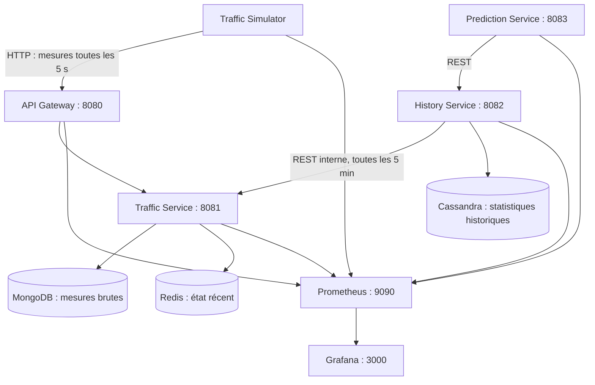

# Urban Traffic Platform

**Plateforme de collecte, de suivi et de prévision du trafic routier.**

Urban Traffic est un projet de démonstration construit autour de plusieurs services Spring Boot. Il reçoit des mesures de circulation, calcule l'état récent des tronçons, conserve un historique agrégé et produit des prévisions de vitesse à partir de profils saisonniers.

Le dépôt inclut un simulateur de trafic, les services applicatifs, les bases de données, le monitoring Prometheus et un tableau de bord Grafana. Les données sont synthétiques : elles servent à tester le fonctionnement de la plateforme et ne décrivent pas la circulation réelle d'Antananarivo.

> **Périmètre :** plateforme de démonstration locale. Le dépôt ne fournit ni frontend métier, ni capteurs physiques, ni broker de messages, ni déploiement Kubernetes.

## Sommaire

- [Fonctionnalités](#fonctionnalités)
- [Architecture](#architecture)
- [Rôle des composants](#rôle-des-composants)
- [Parcours d'une mesure](#parcours-dune-mesure)
- [Stockage des données](#stockage-des-données)
- [Modèle de prévision](#modèle-de-prévision)
- [Installation et démarrage](#installation-et-démarrage)
- [Accès aux services](#accès-aux-services)
- [API REST](#api-rest)
- [Configuration](#configuration)
- [Tests et vérifications](#tests-et-vérifications)
- [Monitoring](#monitoring)
- [Exploitation et dépannage](#exploitation-et-dépannage)
- [Sécurité et limites](#sécurité-et-limites)
- [Structure du dépôt](#structure-du-dépôt)

## Fonctionnalités

- Génération automatique de données de trafic pour dix tronçons.
- Import initial de quatorze jours d'historique synthétique.
- Envoi continu de mesures toutes les cinq secondes.
- Réception et validation de lots de mesures par API REST.
- Détection déterministe du niveau de congestion.
- Conservation des mesures brutes et de l'état récent dans deux stockages distincts.
- Agrégation périodique de l'historique dans Cassandra.
- Prévision de vitesse par tronçon à partir d'un modèle saisonnier explicable.
- Exposition de métriques techniques et métier à Prometheus.
- Tableau de bord Grafana préconfiguré.

Avec les valeurs par défaut, le simulateur produit trois mesures par tronçon pour dix tronçons toutes les cinq secondes :

```text
3 mesures × 10 tronçons = 30 mesures toutes les 5 secondes
30 / 5 = 6 mesures générées par seconde en moyenne
```

Ce chiffre décrit le débit généré par le simulateur, pas une capacité maximale de la plateforme.

## Architecture



Le Gateway est le point d'entrée HTTP des routes applicatives publiques. Les services communiquent aussi directement entre eux sur le réseau Docker pour les échanges internes. Les routes `/internal/**` et `/actuator/**` ne sont pas exposées par le Gateway.

### Rôle des composants

| Composant | Port interne | Responsabilité |
|---|---:|---|
| `gateway` | 8080 | Reçoit les appels HTTP et les redirige vers le service concerné. Il ne porte pas la logique métier du trafic. |
| `traffic-service` | 8081 | Valide les mesures, gère les tronçons, calcule l'état récent et produit les agrégats de trafic. |
| `history-service` | 8082 | Récupère périodiquement les agrégats du Traffic Service et les stocke dans Cassandra. |
| `prediction-service` | 8083 | Entraîne et expose les modèles de prévision de vitesse. Il récupère l'historique par REST. |
| `traffic-simulator` | aucun port REST applicatif | Crée les données synthétiques et envoie les mesures à la Gateway. Il expose seulement ses endpoints de santé et de métriques sur le port de management 9084. |
| Prometheus | 9090 | Interroge les endpoints de métriques des cinq composants applicatifs. |
| Grafana | 3000 | Affiche le tableau de bord construit à partir des métriques Prometheus. |

Les ports de management `9080` à `9084` restent internes au réseau Docker. Les seuls ports publiés sur la machine hôte par défaut sont `8080`, `9090` et `3000`.

## Parcours d'une mesure

Voici le chemin suivi par une mesure de vitesse :

1. Le simulateur construit une mesure contenant un identifiant, un tronçon, un capteur, une position GPS, une vitesse et un horodatage.
2. Il envoie un lot à `POST /api/v1/readings` sur la Gateway.
3. La Gateway transmet la requête au Traffic Service.
4. Le Traffic Service vérifie le lot, le tronçon, les doublons et l'horodatage.
5. La mesure insérée est conservée dans MongoDB.
6. Si elle est suffisamment récente et dans le bon ordre temporel, le service recalcule l'état du tronçon et l'actualise dans Redis.
7. Toutes les cinq minutes, le History Service récupère les fenêtres agrégées closes via l'endpoint interne du Traffic Service et les enregistre dans Cassandra.
8. Le Prediction Service lit cet historique pour entraîner ses modèles et répondre aux demandes de prévision.

### Validation et état temps réel

- Un lot public contient au maximum 500 mesures.
- `readingId` sert de clé d'idempotence : une mesure déjà enregistrée n'est pas insérée une deuxième fois.
- Le tronçon doit exister dans le catalogue.
- Une mesure située à plus d'une minute dans le futur est rejetée par défaut.
- Une mesure de plus de dix minutes peut être conservée dans MongoDB, mais ne remplace pas l'état temps réel Redis.
- Une mesure plus ancienne que la dernière mesure déjà appliquée ne fait pas régresser l'état courant.

Le lissage de vitesse utilise le facteur `0.35` par défaut :

```text
nouvelle_vitesse_lissée = ancienne_vitesse_lissée × 0.65
                          + moyenne_du_lot × 0.35
```

Le but est de réduire les variations trop brusques entre deux lots successifs.

### Classification de congestion

Le niveau est calculé à partir du rapport entre la vitesse lissée et la vitesse limite du tronçon :

```text
ratio = vitesse_lissée / vitesse_limite
```

| Ratio | Niveau |
|---:|---|
| `>= 0.70` | `FREE` |
| `>= 0.40` | `DENSE` |
| `>= 0.15` | `CONGESTED` |
| `< 0.15` | `BLOCKED` |

Il s'agit d'une règle déterministe, pas d'une classification produite par une intelligence artificielle.

## Stockage des données

Les trois bases ont des rôles différents. Elles ne sont pas utilisées comme trois copies interchangeables des mêmes données.

| Stockage | Données conservées | Utilisation dans le projet |
|---|---|---|
| MongoDB | Mesures individuelles, avec leurs champs GPS et temporels | Archiver les relevés bruts et calculer les agrégats par tronçon et fenêtre de cinq minutes. |
| Redis | État récent des tronçons et classement de congestion | Servir rapidement les demandes de trafic actuel. Les entrées expirent après dix minutes par défaut. |
| Cassandra | Statistiques agrégées par tronçon, jour et fenêtre temporelle | Répondre aux consultations historiques et alimenter les modèles de prévision. |

### MongoDB

- Base : `urban_traffic`.
- Collection de mesures : `readings`.
- Collection du catalogue : `road_segments`.
- `readingId` est utilisé comme identifiant de mesure.
- Les index couvrent notamment le tronçon et l'horodatage, le véhicule et l'horodatage, ainsi que la position géographique.
- La rétention des mesures est de sept jours par défaut, avec un index TTL sur l'horodatage.

### Redis

- `segment:{id}` conserve l'état courant d'un tronçon sous forme de hash.
- `congestion:ranking` conserve le classement des tronçons sous forme de sorted set.
- La durée de vie par défaut est de 600 secondes.
- Le projet utilise un script Lua pour mettre à jour de façon atomique l'état et le classement d'un tronçon.

Redis sert au chemin de lecture rapide. Il ne remplace pas l'archive des mesures individuelles.

### Cassandra

- Keyspace : `traffic`.
- Table : `traffic_stats_by_segment_day`.
- La clé de partition repose sur le tronçon et le jour.
- La date de début de fenêtre permet de lire les statistiques dans l'ordre temporel.
- Les écritures sont des upserts, ce qui permet de rejouer un lot sans créer de doublons logiques.

Le nœud Cassandra fourni dans Docker Compose est un nœud unique avec facteur de réplication 1. Cette configuration convient à la démonstration locale, pas à la haute disponibilité.

## Modèle de prévision

Le Prediction Service utilise un modèle saisonnier léger et explicable, implémenté en Java.

Pour chaque tronçon :

1. Le service récupère jusqu'à quatorze jours d'historique depuis le History Service.
2. Les échantillons sont triés chronologiquement.
3. Les 80 % les plus anciens servent à construire le profil.
4. Les 20 % les plus récents servent à évaluer le modèle.
5. Le profil calcule une vitesse moyenne par créneau de quinze minutes et par type de jour : semaine ou week-end.
6. La prévision combine la moyenne saisonnière du créneau visé et une correction basée sur la dernière vitesse connue.

La correction liée à la dernière vitesse décroît avec l'horizon de prévision. Une mesure récente influence donc davantage une prévision proche qu'une prévision éloignée.

Le service calcule la MAE (*Mean Absolute Error*, erreur absolue moyenne) et la compare à une baseline qui reprend la dernière vitesse observée. La MAE exprime un écart moyen en km/h ; ce n'est ni une erreur maximale ni une garantie sur chaque prévision.

Le modèle est entraîné au démarrage, réessayé toutes les trente secondes tant qu'il n'a pas assez d'historique, puis réentraîné toutes les heures. Il lui faut au moins 100 échantillons par tronçon avec la configuration par défaut.

**Important :** les données de test et d'apprentissage initiales sont synthétiques. Une MAE faible sur ce jeu de données ne démontre pas la précision du modèle dans les rues réelles. Le modèle ne calcule pas d'ETA, ne propose pas d'itinéraire et ne modélise pas les événements externes ou les dépendances entre tronçons.

## Installation et démarrage

### Prérequis

- Docker Desktop ou Docker Engine récent.
- Docker Compose v2.
- 8 Go de RAM conseillés. Les limites mémoire déclarées dans Compose totalisent environ 5 184 MiB, sans compter le moteur Docker et le système hôte.
- Ports `8080`, `9090` et `3000` disponibles sur la machine.

Aucun JDK ni Maven local n'est nécessaire pour le lancement avec Docker : les images sont construites à partir des Dockerfiles du dépôt.

### 1. Récupérer le projet et ouvrir son dossier

Dans un terminal, placez-vous à la racine du projet, au niveau de `docker-compose.yml`.

### 2. Créer le fichier d'environnement

**Git Bash, Linux ou macOS :**

```bash
cp .env.example .env
```

**PowerShell :**

```powershell
Copy-Item .env.example .env
```

Le fichier `.env` contient les paramètres locaux. Les valeurs par défaut permettent le démarrage de démonstration.

### 3. Construire et démarrer les conteneurs

```bash
docker compose up --build -d
```

La première construction peut prendre un peu de temps : Docker télécharge les images de base, compile les services Java et démarre les bases de données.

### 4. Contrôler l'état des conteneurs

```bash
docker compose ps
```

Les services applicatifs et les dépendances doivent progressivement atteindre l'état `healthy`. Le simulateur ne devient sain qu'après avoir terminé son initialisation.

### 5. Consulter les journaux

```bash
docker compose logs -f traffic-simulator prediction-service
```

Pour quitter l'affichage des journaux sans arrêter les conteneurs : `Ctrl + C`.

### 6. Exécuter le smoke test

Depuis la racine du projet :

```bash
bash scripts/smoke-test.sh
```

Sur Windows, lancez cette commande depuis **Git Bash** ou WSL, pas depuis un PowerShell qui ne dispose pas de Bash. Le script utilise aussi `curl`, `docker compose`, `date` et `seq`.

Le test vérifie les endpoints de santé internes, Prometheus, Grafana, une ingestion, la lecture de l'état de trafic, l'historique, une prévision, les cibles Prometheus et le tableau de bord Grafana.

## Accès aux services

| Service | Adresse locale | Accès par défaut |
|---|---|---|
| API Gateway | [http://localhost:8080](http://localhost:8080) | API REST, sans authentification dans cette configuration |
| Prometheus | [http://localhost:9090](http://localhost:9090) | Interface de métriques |
| Grafana | [http://localhost:3000](http://localhost:3000) | `admin` / `admin` par défaut |

Le tableau de bord **Trafic** est provisionné au démarrage. L'API Gateway n'est pas une interface graphique : elle expose les endpoints REST.

Les bases MongoDB, Redis et Cassandra ne publient pas leurs ports sur l'hôte. Les ports Actuator `9080` à `9084` restent eux aussi accessibles uniquement depuis le réseau Docker.

## API REST

Toutes les routes applicatives publiques passent par la Gateway sur `http://localhost:8080`.

### Tronçons

Créer ou mettre à jour un tronçon :

```bash
curl -X POST http://localhost:8080/api/v1/segments \
  -H 'Content-Type: application/json' \
  -d '{"id":"avenue-01","name":"Avenue principale","speedLimitKmh":50}'
```

Lister le catalogue :

```bash
curl http://localhost:8080/api/v1/segments
```

### Ingestion de mesures

```bash
curl -X POST http://localhost:8080/api/v1/readings \
  -H 'Content-Type: application/json' \
  -d '{"readings":[{"readingId":"demo-001","segmentId":"avenue-01","sensorId":"capteur-01","type":"FIXED","location":{"latitude":-18.8792,"longitude":47.5079},"speedKmh":12.5,"timestamp":"2026-11-16T08:00:00Z"}]}'
```

Les valeurs de position et d'horodatage de cet exemple sont illustratives. Pour un essai réel, utilisez un identifiant de mesure unique, un tronçon déjà enregistré et un horodatage compatible avec les règles de fraîcheur.

### État du trafic

```bash
# État d'un tronçon
curl http://localhost:8080/api/v1/traffic/segments/segment-01

# Cinq tronçons les plus congestionnés
curl 'http://localhost:8080/api/v1/traffic/congestion/top?n=5'

# Filtrer les tronçons congestionnés
curl 'http://localhost:8080/api/v1/traffic/segments?level=CONGESTED'
```

### Historique et prévisions

```bash
# Historique d'un tronçon
curl 'http://localhost:8080/api/v1/history/segments/segment-01?from=2026-11-01T00:00:00Z&to=2026-11-14T00:00:00Z&granularity=1h&page=0&size=100'

# Prévision de vitesse à 30 minutes
curl 'http://localhost:8080/api/v1/predictions/segments/segment-01?horizonMinutes=30'

# Tronçons classés selon leur vitesse prévue
curl 'http://localhost:8080/api/v1/predictions/hotspots?horizonMinutes=30'

# État des modèles et métriques d'évaluation
curl http://localhost:8080/api/v1/predictions/model
```

Les fenêtres historiques sont limitées à 31 jours par requête. L'horizon de prévision accepté est compris entre 1 et 120 minutes. Un modèle qui n'a pas encore été entraîné renvoie `503 Service Unavailable`.

### Référence des principales routes

| Méthode | Route | Service | Description |
|---|---|---|---|
| `POST` | `/api/v1/readings` | Traffic Service | Insérer un lot de 1 à 500 mesures. |
| `GET` | `/api/v1/traffic/segments/{id}` | Traffic Service | Lire l'état récent d'un tronçon depuis Redis. |
| `GET` | `/api/v1/traffic/segments?level=` | Traffic Service | Filtrer les tronçons par niveau de congestion. |
| `GET` | `/api/v1/traffic/congestion/top?n=` | Traffic Service | Obtenir le classement de congestion, de 1 à 50 tronçons. |
| `GET` | `/api/v1/vehicles/{id}/trajectory?from=&to=` | Traffic Service | Obtenir une trajectoire GeoJSON `LineString` ; les coordonnées sont ordonnées `[longitude, latitude]`. |
| `POST` | `/api/v1/segments` | Traffic Service | Créer ou mettre à jour un tronçon. |
| `GET` | `/api/v1/segments` | Traffic Service | Lister le catalogue des tronçons. |
| `GET` | `/api/v1/history/segments/{id}?from=&to=&granularity=&page=&size=` | History Service | Lire l'historique paginé avec granularité `5m`, `1h` ou `1d`. |
| `POST` | `/api/v1/history/import` | History Service | Importer des statistiques par lots de 1 à 5 000 points. |
| `GET` | `/api/v1/predictions/segments/{id}?horizonMinutes=` | Prediction Service | Prévoir la vitesse d'un tronçon, horizon de 1 à 120 minutes. |
| `GET` | `/api/v1/predictions/hotspots?horizonMinutes=30` | Prediction Service | Classer les tronçons du plus lent au plus rapide selon la vitesse prévue. |
| `GET` | `/api/v1/predictions/model` | Prediction Service | Lire l'état des modèles, la date d'entraînement, la MAE et la baseline. |

L'endpoint `/internal/aggregates?from=&to=` du Traffic Service est réservé aux communications internes et n'est pas publié par la Gateway. Les endpoints `/actuator/**` ne sont pas routés par la Gateway non plus.

## Configuration

Les variables sont documentées dans `.env.example`. Les valeurs les plus utiles sont regroupées ci-dessous.

| Variable | Valeur par défaut | Rôle |
|---|---:|---|
| `GATEWAY_PORT` | `8080` | Port publié de l'API |
| `PROMETHEUS_PORT` | `9090` | Port publié de Prometheus |
| `GRAFANA_PORT` | `3000` | Port publié de Grafana |
| `MONGO_RETENTION_DAYS` | `7` | Durée de rétention des mesures MongoDB |
| `REDIS_TTL_SECONDS` | `600` | Durée de vie des états Redis |
| `TRAFFIC_MAX_BATCH_SIZE` | `500` | Nombre maximal de mesures par lot public |
| `TRAFFIC_SMOOTHING_FACTOR` | `0.35` | Poids de la nouvelle moyenne dans le lissage |
| `TRAFFIC_MAX_READING_AGE` | `10m` | Âge maximal pour modifier l'état temps réel |
| `TRAFFIC_MAX_FUTURE_SKEW` | `1m` | Décalage futur maximal accepté |
| `CONGESTION_FREE_RATIO` | `0.70` | Seuil du niveau `FREE` |
| `CONGESTION_DENSE_RATIO` | `0.40` | Seuil du niveau `DENSE` |
| `CONGESTION_CONGESTED_RATIO` | `0.15` | Seuil du niveau `CONGESTED` |
| `HISTORY_COLLECTOR_FIXED_RATE_MS` | `300000` | Cadence de collecte de l'historique, cinq minutes |
| `HISTORY_MAX_RANGE_DAYS` | `31` | Période maximale de consultation historique |
| `PREDICTION_LOOKBACK_DAYS` | `14` | Profondeur d'historique pour l'entraînement |
| `PREDICTION_MINIMUM_SAMPLES` | `100` | Nombre minimal d'échantillons par tronçon |
| `PREDICTION_TRAINING_FIXED_RATE_MS` | `3600000` | Cadence de réentraînement, une heure |
| `PREDICTION_RETRY_FIXED_DELAY_MS` | `30000` | Réessai avant disponibilité du premier modèle |
| `SIMULATOR_SEED_DAYS` | `14` | Durée de l'historique synthétique initial |
| `SIMULATOR_INTERVAL_MS` | `5000` | Intervalle entre les lots du simulateur |
| `SIMULATOR_SEGMENT_COUNT` | `10` | Nombre de tronçons synthétiques |
| `SIMULATOR_MEASUREMENTS_PER_SEGMENT` | `3` | Mesures par tronçon et par lot |

Les versions des images Docker, les paramètres Cassandra et les identifiants Grafana locaux sont également définis dans `.env.example`.

## Tests et vérifications

### Tests Maven

Pour lancer les tests depuis l'hôte, il faut Java 21 et Maven 3.9 ou une version plus récente :

```bash
mvn -B -ntp test
```

Les tests couvrent notamment :

- la classification de congestion ;
- les statistiques de vitesse ;
- la validation des requêtes ;
- l'ingestion, les doublons et les mesures anciennes ou désordonnées ;
- l'agrégation historique ;
- le modèle saisonnier et sa comparaison avec la baseline ;
- les dépôts de persistance avec Testcontainers lorsque Docker est disponible.

Certains tests d'intégration sont automatiquement désactivés lorsque Docker n'est pas disponible. Le fait qu'un test existe ne signifie pas qu'il a été exécuté dans tous les environnements.

### Smoke test Docker

```bash
bash scripts/smoke-test.sh
```

Le smoke test valide le fonctionnement de l'ensemble déjà démarré. Il ne remplace pas les tests de charge, de sécurité, de résilience ou une validation sur des mesures routières réelles.

## Monitoring

Prometheus interroge les cinq composants toutes les cinq secondes. Les endpoints de métriques sont internes au réseau Docker :

| Cible Prometheus | Endpoint |
|---|---|
| Gateway | `gateway:9080/actuator/prometheus` |
| Traffic Service | `traffic-service:9081/actuator/prometheus` |
| History Service | `history-service:9082/actuator/prometheus` |
| Prediction Service | `prediction-service:9083/actuator/prometheus` |
| Traffic Simulator | `traffic-simulator:9084/actuator/prometheus` |

Exemples de métriques :

- `traffic_readings_ingested_total` : nombre de mesures ingérées ;
- `traffic_segments_congested` : nombre de tronçons congestionnés ;
- `traffic_avg_speed_kmh` : vitesse moyenne par tronçon ;
- `traffic_forecast_mae` : erreur absolue moyenne de prévision.

Le tableau de bord Grafana **Trafic** présente notamment la congestion, les vitesses, le débit des mesures, la MAE, la mémoire JVM et le débit HTTP par service.

## Exploitation et dépannage

### Vérifier les conteneurs

```bash
docker compose ps
```

### Voir les logs d'un composant

```bash
docker compose logs -f traffic-service
docker compose logs -f history-service
docker compose logs -f prediction-service
docker compose logs -f traffic-simulator
```

### Cassandra met du temps à démarrer

```bash
docker compose logs -f cassandra cassandra-init
```

Attendez que Cassandra soit saine et que le conteneur `cassandra-init` ait terminé la création du schéma. Le conteneur d'initialisation peut s'arrêter normalement après cette tâche.

### Le modèle de prévision n'est pas encore disponible

```bash
docker compose logs -f prediction-service
```

Le service peut signaler qu'il n'a pas encore assez d'historique. Il réessaie toutes les trente secondes jusqu'à ce qu'un modèle puisse être entraîné. Après le seed initial, il faut laisser le collecteur alimenter l'historique.

### Un port est déjà utilisé

Vérifiez les applications qui occupent les ports `8080`, `9090` ou `3000`, ou modifiez les variables correspondantes dans `.env` avant de relancer Compose.

### Arrêter les conteneurs

```bash
docker compose down
```

Cette commande arrête et supprime les conteneurs et le réseau, mais conserve les volumes de données.

### Repartir de zéro

```bash
docker compose down -v
docker compose up --build -d
```

`docker compose down -v` supprime les volumes nommés de la démonstration, dont MongoDB, Redis, Cassandra, Prometheus et Grafana. Les données locales seront perdues.

## Sécurité et limites

Cette configuration est destinée à un environnement local de démonstration.

- MongoDB, Redis et Cassandra n'ont pas d'authentification configurée.
- Grafana utilise `admin` / `admin` par défaut ; changez ces identifiants avant tout usage non local.
- Aucun TLS, RBAC, gestionnaire de secrets ou mécanisme de limitation de débit n'est configuré.
- Les ports de bases de données et de management ne sont pas publiés sur l'hôte par défaut. Ne modifiez pas cette configuration pour exposer ces composants sans ajouter les contrôles nécessaires.
- Cassandra fonctionne en nœud unique avec réplication 1 : il n'y a pas de haute disponibilité.
- Les données de circulation sont générées artificiellement autour d'un centre géographique par défaut situé à Antananarivo.
- Le modèle de prévision est simple, saisonnier et entraîné sur les données synthétiques du projet.
- Les mesures brutes MongoDB sont conservées sept jours par défaut ; les états Redis expirent après dix minutes ; les agrégats Cassandra restent disponibles jusqu'à suppression ou modification explicite.
- Les échanges entre services utilisent REST. Aucun Kafka ou RabbitMQ n'est présent.
- Docker Compose démarre l'environnement local ; Kubernetes n'est pas utilisé.
- Aucun frontend métier React/Vue n'est livré. Grafana sert au monitoring, pas à la gestion fonctionnelle du trafic.

Pour un déploiement réel, il faudrait notamment intégrer des mesures terrain, sécuriser les communications et les accès, prévoir sauvegardes et restauration, tester la capacité sous charge, renforcer la haute disponibilité et réévaluer les versions logicielles avant mise en production.

## Structure du dépôt

```text
.
├── docker-compose.yml
├── .env.example
├── pom.xml
├── Makefile
├── README.md
├── docs/
│   └── architecture.md
├── infra/
│   ├── cassandra/
│   │   └── schema.cql
│   ├── grafana/
│   │   ├── dashboards/
│   │   └── provisioning/
│   └── prometheus/
│       └── prometheus.yml
├── scripts/
│   └── smoke-test.sh
└── services/
    ├── gateway/
    ├── traffic-service/
    ├── history-service/
    ├── prediction-service/
    └── traffic-simulator/
```

Chaque service possède son propre `pom.xml` et son Dockerfile. Le `pom.xml` à la racine regroupe les cinq modules Maven.

### Raccourcis Makefile

Si `make` est installé, les commandes suivantes sont disponibles à la racine :

| Commande | Effet |
|---|---|
| `make up` | Construire puis démarrer l'environnement Docker. |
| `make down` | Arrêter et supprimer les conteneurs sans effacer les volumes. |
| `make logs` | Afficher les journaux des conteneurs. |
| `make test` | Exécuter les tests Maven. |
| `make smoke` | Lancer le script de smoke test. |
| `make clean` | Supprimer les volumes Docker et les dossiers `target` des services. |

`make clean` est destructif pour les données de la démonstration, car il appelle `docker compose down -v`.

### Versions principales du dépôt

| Composant | Version déclarée dans le dépôt |
|---|---|
| Java | 21 |
| Spring Boot | 3.5.16 |
| Spring Cloud | 2025.0.3, pour la Gateway |
| Maven dans les images de build | 3.9.16 |
| MongoDB | 7.0.48 |
| Redis | 7.4.12 |
| Cassandra | 4.1.12 |
| Prometheus | 3.16.0 |
| Grafana OSS | 13.3.1 |

Ces versions décrivent la configuration présente dans ce dépôt. Avant un usage durable ou une mise en production, vérifiez leur état de maintenance et planifiez les mises à jour nécessaires.
